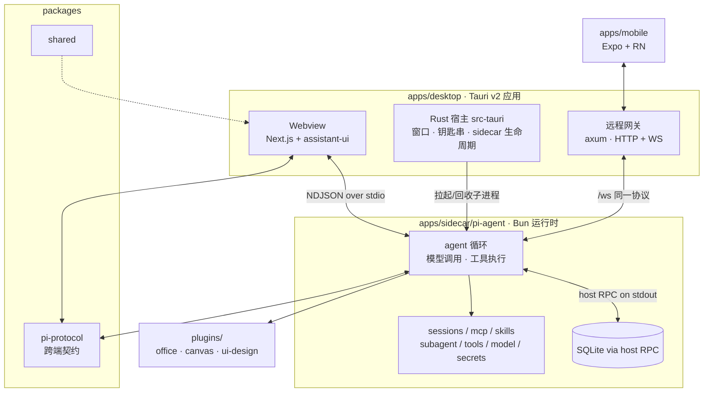

扣瓦是一个四层 monorepo。理解这四层怎么分，比读任何单个文件都有用。

## 分层



## apps/desktop

桌面前端，Next.js + [assistant-ui](https://assistant-ui.com)。
主要目录：

| 路径 | 内容 |
| --- | --- |
| `components/agent-thread` | 会话流渲染 |
| `components/settings` | 设置页与各能力分区 |
| `components/code` `components/files` | 编辑器与文件树 |
| `components/agents` | 子代理管理界面 |
| `components/marketplace` | 插件市场 |
| `components/automations` | 定时任务 |
| `components/remote` | 远程网关与配对设备 |
| `src-tauri/` | Rust 宿主 |

Rust 宿主负责 Rust 侧的事：窗口与自定义标题栏、系统钥匙串、
sidecar 子进程的拉起与回收，以及把业务表的读写以 **host RPC** 的形式
提供给 sidecar。

<Note>
  业务数据不直接由 sidecar 写文件或开 SQLite 连接，而是通过 stdout 上的
  host RPC 交给宿主执行。这是为什么在没有 Rust 宿主时
  （例如 `bun run smoke`）sidecar 会回退到本地 SQLite 存储。
</Note>

## apps/sidecar/pi-agent

Agent 运行时，Bun + TypeScript。入口 `src/index.ts`，
对外是 stdin/stdout 上的 **NDJSON 协议**，按域分目录：

```text
src/
  agent/        agent 循环与上下文管理
  automation/   定时任务
  goal/         goal 模式
  mcp/          MCP 客户端与配置合并
  model/        模型供应商接入
  permissions/  模式与权限档位
  plugins/      插件装载
  protocol/     NDJSON 协议实现
  secrets/      凭据读取
  sessions/     会话存储
  skills/       技能装载
  storage/      存储层
  subagent/     子代理调度
  tools/        内置工具
  observability/ 可观测性
```

## apps/mobile

Expo SDK 57 + React Native 0.86。无后端——
经桌面远程网关的 `/ws` 连 sidecar，配对码换 token 存 Keychain/Keystore。
详见 [远程与移动端](/features/remote-mobile)。

## packages

- **pi-protocol**：前后端共享的跨端契约定义。桌面前端、sidecar 与移动端
  都从这里取类型，避免三端各写一套。
- **shared**：桌面侧的共享工具与组件。

## plugins

见 [插件与工作台](/features/plugins)。

## 数据流向：一次工具调用

<Steps>
  <Step title="前端发出请求">
    会话流渲染时，前端通过 NDJSON 向 sidecar 发一条消息。
  </Step>
  <Step title="sidecar 决定调什么">
    agent 循环把消息交给模型，模型返回工具调用。
    sidecar 按当前会话模式与权限档位检查这次调用是否放行。
  </Step>
  <Step title="可能要问你">
    如果需要审批，sidecar 推一条审批事件给前端，
    前端弹审批卡。你的选择回传 sidecar。
  </Step>
  <Step title="执行并落库">
    工具在 sidecar 内执行。涉及业务表的写入通过 stdout 上的 host RPC
    交给 Rust 宿主执行，宿主访问系统钥匙串与 SQLite。
  </Step>
  <Step title="回推事件">
    工具结果与流式增量以事件形式推回前端，
    渲染成对话流里的一次工具调用记录，并落检查点。
  </Step>
</Steps>

## 为什么把 agent 拆成独立进程

- **界面不卡**：长任务和大量工具输出不会阻塞渲染进程；
- **崩溃隔离**：sidecar 出问题不会带走整个窗口；
- **多端复用**：移动端和网页端接的是同一个 WS 端点与同一套运行时，
  不需要第二份实现；
- **可独立测试**：`bun run smoke` 能在没有 GUI 的环境里跑完整的协议握手。

## 站在别人的肩膀上

会话转录、上下文压缩、子代理等核心设计移植/参考自
Earendil Works 的 [pi-agent](https://www.npmjs.com/package/@earendil-works/pi-agent-core)。
代码注释里大量出现的 `PI-Desktop 同设计` 标注就指向这些出处。

<Card title="下一步" icon="arrow-right" href="/developers/extending">
  在这个分层之上加你自己的东西。
</Card>