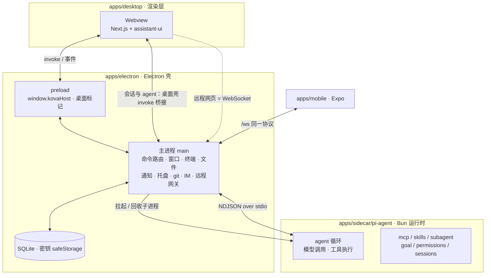

扣瓦是一个 monorepo。理解几层怎么分，比读任何单个文件都有用：
**主进程**管系统，**渲染层**管界面，**sidecar** 是 agent 本体，三者经两条通道协作。

## 分层



三条通信通道，各管各的：

- **渲染层 ↔ 主进程**：`window.kovaHost` 上的 invoke / 事件（窗口、对话框、路径、
  文件、通知等系统能力，以及会话与 agent 请求的桥接）；
- **主进程 ↔ sidecar**：stdin/stdout 上的 **NDJSON 协议**，sidecar 由主进程拉起为子进程；
- **远程客户端 ↔ 主进程**：`/ws` WebSocket，与桌面同一套跨端契约。

## apps/electron

Electron 壳。`main/` 是主进程：命令路由与系统能力——窗口与自定义标题栏、
终端（pty）、文件、通知、托盘、git、IM 通道、远程网关、密钥加密与 SQLite
（`node:sqlite`，不可用时回退 better-sqlite3）。`preload/` 暴露 `window.kovaHost`
与 `__KOVA_DESKTOP__` 桌面标记、拖拽区桥。

<Note>
  会话与业务数据不直接由 sidecar 写文件或开 SQLite 连接，而是通过 stdio 上的
  host 桥交给主进程执行——密钥解密、业务表读写都在主进程侧完成。
  这也是为什么 sidecar 能独立进程测试：没有宿主时它回退到本地存储。
</Note>

## apps/desktop

桌面前端，Next.js + [assistant-ui](https://assistant-ui.com)。主要目录：

| 路径 | 内容 |
| --- | --- |
| `components/agent-thread` | 会话流渲染 |
| `components/settings` | 设置页与各能力分区 |
| `components/code` `components/files` | 编辑器与文件树 |
| `components/agents` | 子代理管理界面 |
| `components/marketplace` | 插件市场 |
| `components/automations` | 定时任务 |
| `components/remote` `lib/im` | 远程网关与 IM 通道 |
| `lib/pi` | 与 sidecar 的请求-响应桥（传输由桌面壳 invoke / 远程 WS 决定） |

## apps/sidecar/pi-agent

Agent 运行时，Bun + TypeScript，构建为单文件二进制 `kova-worker`。
对外是 stdin/stdout 上的 **NDJSON 协议**，按域分目录：

```text
src/
  agent/        agent 循环与上下文管理
  automation/   定时任务
  checkpoint/   逐文件检查点
  goal/         goal 模式
  knowledge/    知识源
  mcp/          MCP 客户端与配置合并
  model/        模型供应商接入与动态发现
  permissions/  模式与权限档位
  plugins/      插件装载与市场
  protocol/     NDJSON 协议实现
  secrets/      凭据读取与注入
  sessions/     会话存储
  skills/       技能装载
  storage/      存储层
  subagent/     子代理调度
  tools/        内置工具
  observability/ 可观测性
```

## apps/mobile

Expo + React Native。无后端——经桌面远程网关的 `/ws` 连 sidecar，
配对码换 token。详见[远程与移动端](/features/remote-mobile)。

## packages

- **pi-protocol**：跨端契约单源。渲染层、sidecar、移动端都从这里取类型。
- **pi-runtime**：会话运行时状态与回放。
- **pi-sandbox**：沙箱执行边界。
- **automation-core** / **knowledge-core**：定时任务与知识源的核心逻辑。
- **pi-agent-core / pi-ai**：内嵌的 agent 运行时与模型接入库（见下方致谢）。

## 数据流向：一次工具调用

<Steps>
  <Step title="渲染层发出请求">
    会话流里你发一条消息，渲染层经桌面壳 invoke 桥把请求交给主进程，
    主进程转发给 sidecar。
  </Step>
  <Step title="sidecar 决定调什么">
    agent 循环把消息交给模型，模型返回工具调用。
    sidecar 按当前会话模式与权限档位检查这次调用是否放行。
  </Step>
  <Step title="可能要问你">
    如果需要审批，sidecar 推一条审批事件，前端弹审批卡。你的选择回传 sidecar。
  </Step>
  <Step title="执行并落库">
    工具在 sidecar 内执行。涉及业务表的写入通过 host 桥交给主进程执行，
    密钥解密与 SQLite 访问都在主进程侧。
  </Step>
  <Step title="回推事件">
    工具结果与流式增量以事件形式推回前端，渲染成对话流里的一次工具调用记录，
    并落检查点。
  </Step>
</Steps>

## 为什么把 agent 拆成独立进程

- **界面不卡**：长任务和大量工具输出不会阻塞渲染进程；
- **崩溃隔离**：sidecar 出问题不会带走整个窗口；
- **多端复用**：移动端、网页端与桌面接的是同一套运行时，不需要第二份实现；
- **可独立测试**：sidecar 能在没有 GUI 的环境里跑完整的协议握手。

## 站在别人的肩膀上

会话转录、上下文压缩、子代理等核心设计移植/参考自
Earendil Works 的 [pi](https://github.com/earendil-works/pi)。
代码注释里大量出现的 `PI-Desktop 同设计` 标注就指向这些出处。

<Card title="下一步" icon="arrow-right" href="/developers/extending">
  在这个分层之上加你自己的东西。
</Card>
