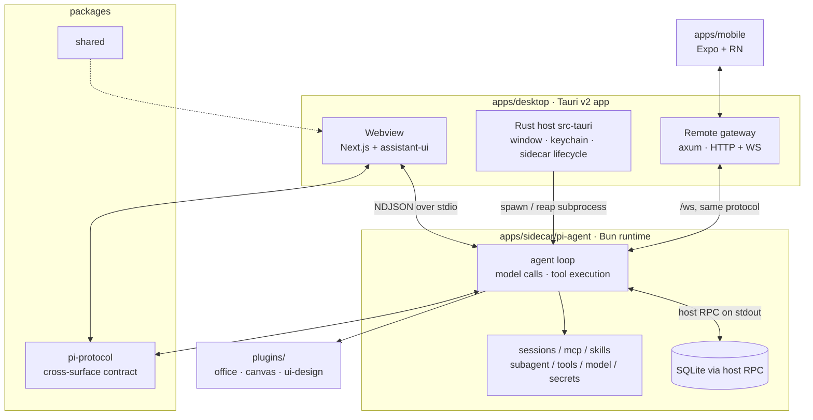

Kova is a four-layer monorepo. Understanding how these four divide the work is more
useful than reading any single file.

## The layers



## apps/desktop

The desktop frontend: Next.js plus [assistant-ui](https://assistant-ui.com).

| Path | Contents |
| --- | --- |
| `components/agent-thread` | Conversation stream rendering |
| `components/settings` | Settings page and per-capability sections |
| `components/code` `components/files` | Editor and file tree |
| `components/agents` | Subagent management UI |
| `components/marketplace` | Plugin marketplace |
| `components/automations` | Scheduled tasks |
| `components/remote` | Remote gateway and paired devices |
| `src-tauri/` | Rust host |

The Rust host owns the Rust-side concerns: the window and custom title bar, the system
keychain, spawning and reaping the sidecar subprocess, and exposing business-table reads
and writes to the sidecar as **host RPC**.

<Note>
  The sidecar does not write files or open SQLite connections for business data — that
  work is handed to the host over host RPC on stdout. This is exactly why the sidecar
  falls back to local SQLite storage when there is no Rust host, as in `bun run smoke`.
</Note>

## apps/sidecar/pi-agent

The agent runtime, Bun + TypeScript. Entry point `src/index.ts`, exposing an **NDJSON
protocol** on stdin/stdout, organised by domain:

```text
src/
  agent/          agent loop and context management
  automation/     scheduled tasks
  goal/           goal mode
  mcp/            MCP client and config merging
  model/          model provider integrations
  permissions/    modes and approval levels
  plugins/        plugin loading
  protocol/       NDJSON protocol implementation
  secrets/        credential reads
  sessions/       session storage
  skills/         skill loading
  storage/        storage layer
  subagent/       subagent scheduling
  tools/          built-in tools
  observability/  tracing
```

## apps/mobile

Expo SDK 57 + React Native 0.86. No backend — it connects to the sidecar through the
desktop gateway's `/ws`, exchanging a pairing code for a token stored in the
Keychain/Keystore. See [Remote & mobile](/en/features/remote-mobile).

## packages

- **pi-protocol** — the cross-surface contract shared by frontend, sidecar, and mobile.
  All three take their types from here, so nobody writes a fourth copy.
- **shared** — utilities and components shared on the desktop side.

## plugins

See [Plugins & workspaces](/en/features/plugins).

## Data flow: one tool call

<Steps>
  <Step title="The frontend sends">
    While rendering the thread, the frontend sends a message to the sidecar over NDJSON.
  </Step>
  <Step title="The sidecar decides">
    The agent loop hands the message to the model, which returns tool calls. The sidecar
    checks each call against the current session mode and approval level.
  </Step>
  <Step title="It may stop and ask">
    If approval is required, the sidecar pushes an approval event to the frontend, which
    shows the card. Your choice goes back to the sidecar.
  </Step>
  <Step title="Execute and persist">
    The tool runs inside the sidecar. Writes that touch business tables go to the Rust
    host over host RPC on stdout, where the keychain and SQLite live.
  </Step>
  <Step title="Push events back">
    Results and streaming deltas return to the frontend as events, render as a tool-call
    record in the thread, and land in a checkpoint.
  </Step>
</Steps>

## Why the agent is a separate process

- **The UI stays responsive** — long jobs and heavy tool output never block the render
  process;
- **Crash isolation** — a sidecar failure does not take the window down with it;
- **Reuse across surfaces** — mobile and web connect to the same WS endpoint and the
  same runtime, so there is no second implementation;
- **Testable in isolation** — `bun run smoke` runs the full protocol handshake with no
  GUI at all.

## Standing on other people's work

Session transcripts, context compaction, and the subagent model are ported from or
modelled on Earendil Works'
[pi-agent](https://www.npmjs.com/package/@earendil-works/pi-agent-core). The many
`PI-Desktop 同设计` comments in the code point at those sources.

<Card title="Next" icon="arrow-right" href="/en/developers/extending">
  Build your own thing on top of these layers.
</Card>