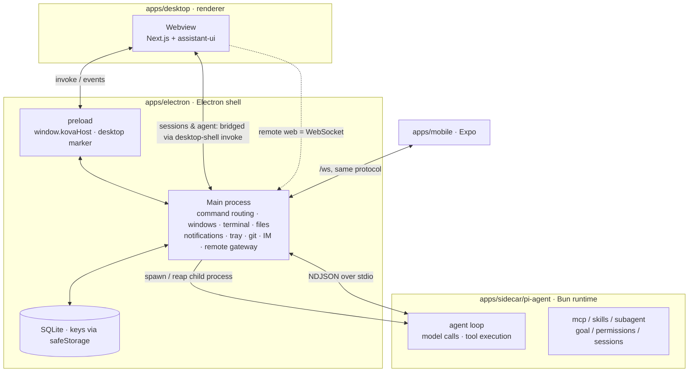

Kova is a monorepo. Understanding how the layers divide the work is more useful than
reading any single file: the **main process** owns the system, the **renderer** owns the
UI, and the **sidecar** is the agent itself. They cooperate over two channels.

## The layers



Three communication channels, each with its own job:

- **Renderer ↔ main**: invoke / events over `window.kovaHost` (windows, dialogs, paths,
  files, notifications, plus the bridge for session and agent requests);
- **Main ↔ sidecar**: the **NDJSON protocol** over stdin/stdout; the main process spawns
  the sidecar as a child process;
- **Remote clients ↔ main**: `/ws` WebSocket, using the same cross-surface contract as
  the desktop.

## apps/electron

The Electron shell. `main/` is the main process: command routing and system capabilities —
windows and custom title bars, terminal (pty), files, notifications, tray, git, IM
channels, the remote gateway, key encryption, and SQLite (`node:sqlite`, falling back to
better-sqlite3). `preload/` exposes `window.kovaHost`, the `__KOVA_DESKTOP__` marker, and
the drag-region bridge.

<Note>
  Session and business data are not written directly by the sidecar; they go through the
  host bridge over stdio to the main process — key decryption and table access both happen
  there. That is also why the sidecar is testable as a standalone process: without a host
  it falls back to local storage.
</Note>

## apps/desktop

The desktop frontend, Next.js + [assistant-ui](https://assistant-ui.com). Main directories:

| Path | Contents |
| --- | --- |
| `components/agent-thread` | Conversation stream rendering |
| `components/settings` | Settings pages and capability sections |
| `components/code` `components/files` | Editor and file tree |
| `components/agents` | Subagent management UI |
| `components/marketplace` | Plugin marketplace |
| `components/automations` | Scheduled tasks |
| `components/remote` `lib/im` | Remote gateway and IM channels |
| `lib/pi` | Request/response bridge to the sidecar (transport chosen by desktop-shell invoke / remote WS) |

## apps/sidecar/pi-agent

The agent runtime, Bun + TypeScript, built as a single binary `kova-worker`.
It speaks the **NDJSON protocol** on stdin/stdout, organized by domain:

```text
src/
  agent/        agent loop and context management
  automation/   scheduled tasks
  checkpoint/   per-file checkpoints
  goal/         goal mode
  knowledge/    knowledge sources
  mcp/          MCP client and config merging
  model/        model provider access and dynamic discovery
  permissions/  modes and approval levels
  plugins/      plugin loading and markets
  protocol/     NDJSON protocol implementation
  secrets/      credential reads and injection
  sessions/     session storage
  skills/       skill loading
  storage/      storage layer
  subagent/     subagent scheduling
  tools/        built-in tools
  observability/ observability
```

## apps/mobile

Expo + React Native. No backend — it connects to the sidecar through the desktop remote
gateway's `/ws` and trades a pairing code for a token. See
[Remote access & mobile](/en/features/remote-mobile).

## packages

- **pi-protocol**: the single source of cross-surface contracts. The renderer, sidecar,
  and mobile app all take types from here.
- **pi-runtime**: session runtime state and replay.
- **pi-sandbox**: sandbox execution boundaries.
- **automation-core** / **knowledge-core**: scheduled-task and knowledge-source core logic.
- **pi-agent-core / pi-ai**: the embedded agent runtime and model access libraries (see
  the acknowledgements below).

## Data flow: one tool call

<Steps>
  <Step title="The renderer sends a request">
    You send a message in the thread; the renderer hands it to the main process via the
    desktop-shell invoke bridge, and the main process forwards it to the sidecar.
  </Step>
  <Step title="The sidecar decides what to call">
    The agent loop passes the message to the model, which returns tool calls. The sidecar
    checks whether this call is allowed under the session mode and approval level.
  </Step>
  <Step title="It may need to ask you">
    If approval is needed, the sidecar pushes an approval event and the UI shows a card;
    your choice goes back to the sidecar.
  </Step>
  <Step title="Execute and persist">
    The tool runs inside the sidecar. Business-table writes go through the host bridge to
    the main process, where key decryption and SQLite access live.
  </Step>
  <Step title="Push events back">
    Tool results and streaming deltas are pushed back to the renderer as thread events,
    rendered into the conversation, and checkpointed.
  </Step>
</Steps>

## Why the agent runs in a separate process

- **The UI never stalls**: long jobs and large tool outputs do not block the renderer;
- **Crash isolation**: a sidecar failure does not take the window down with it;
- **Multi-surface reuse**: mobile, web, and desktop all use the same runtime — no second
  implementation;
- **Independent testing**: the sidecar can run a full protocol handshake with no GUI.

## Standing on the shoulders of others

Conversation transcripts, context compaction, and subagents are ported/derived from
Earendil Works' [pi](https://github.com/earendil-works/pi). The many `PI-Desktop 同设计`
annotations in code comments point back to those origins.

<Card title="Next" icon="arrow-right" href="/en/developers/extending">
  Add your own pieces on top of these layers.
</Card>
