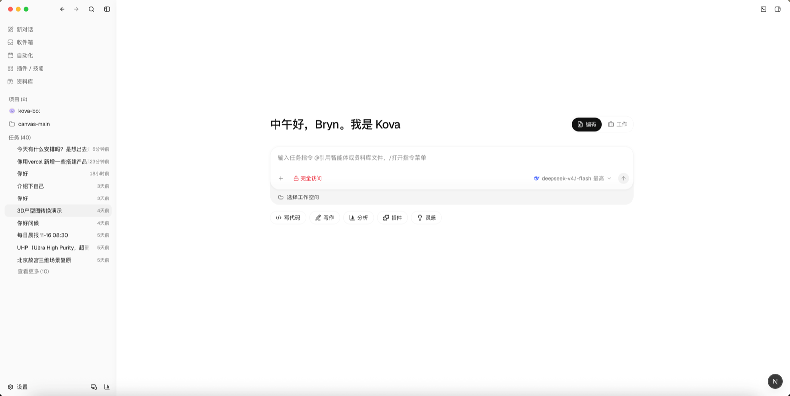

An AI assistant that runs on your own desktop: a native window + an isolated
local agent runtime (sidecar) + a constraint-driven permission model.
**v1.2.0 · Apache-2.0 open source**.

## Download

| Platform | Download |
| --- | --- |
| macOS (Apple Silicon) | [Kova_1.2.0_arm64.dmg](https://github.com/xqb0407/kova/releases/download/v1.2.0/Kova_1.2.0_arm64.dmg) |
| Windows (x64) | [Kova_1.2.0_x64-setup.exe](https://github.com/xqb0407/kova/releases/download/v1.2.0/Kova_1.2.0_x64-setup.exe) |

SHA256 checksums (`SHA256SUMS-macos.txt` / `SHA256SUMS-windows.txt`) are on the
[Release page](https://github.com/xqb0407/kova/releases/tag/v1.2.0).

- **macOS**: ad-hoc signed — if Gatekeeper blocks the first launch,
  right-click the app → "Open"
- **Windows**: unsigned — when SmartScreen warns, choose
  "More info → Run anyway"



## Quickstart

After installing, open **Settings → Models** and add an API key
(AES-256-GCM encrypted locally, wrapped by the system keychain) to start
chatting. To run from source (contributing / rebranding):

```bash
git clone https://github.com/xqb0407/kova.git
cd kova
bun install
bun run dev
```

Full steps and FAQs in **[Quickstart](/en/quickstart)**.

## Docs map

<Columns cols={2}>
  <Card
    title="Conversation & agent"
    href="/en/features/conversation"
  >
    Multi-threaded sessions, agent engine and turn loop, model providers,
    web search configuration, prompt cache and queue, modes, sandbox,
    goal mode, subagents.
  </Card>
  <Card
    title="Extending & scenarios"
    href="/en/features/mcp"
  >
    MCP integration, plugins and workbenches, automations, IM channels,
    remote & mobile, managed git worktrees.
  </Card>
  <Card
    title="Security & keys"
    href="/en/features/security"
  >
    Encrypted key storage, tool-output redaction, MCP secret injection
    boundaries.
  </Card>
  <Card
    title="Developers"
    href="/en/developers/architecture"
  >
    Three-layer architecture, extending guide, release process and version
    management.
  </Card>
</Columns>

<Card title="Roadmap & license" href="/en/reference/roadmap">
  What's next, and the open-source license (Apache-2.0).
</Card>
