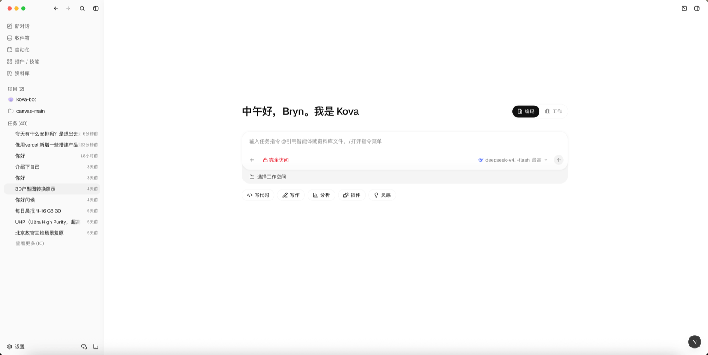

跑在你自己桌面上的 AI 助手：原生窗口 + 独立本地 Agent 运行时（sidecar）+
可约束的权限模型。**v1.2.0 · Apache-2.0 开源**。

## 下载安装

| 平台 | 下载 |
| --- | --- |
| macOS（Apple Silicon） | [Kova_1.2.0_arm64.dmg](https://github.com/xqb0407/kova/releases/download/v1.2.0/Kova_1.2.0_arm64.dmg) |
| Windows（x64） | [Kova_1.2.0_x64-setup.exe](https://github.com/xqb0407/kova/releases/download/v1.2.0/Kova_1.2.0_x64-setup.exe) |

SHA256 校验文件（`SHA256SUMS-macos.txt` / `SHA256SUMS-windows.txt`）在
[Release 页](https://github.com/xqb0407/kova/releases/tag/v1.2.0)。

- **macOS**：ad-hoc 签名，首次打开若被 Gatekeeper 拦截 → 右键点击应用 →「打开」
- **Windows**：未签名，SmartScreen 提示时选「更多信息 → 仍要运行」



## 快速开始

装好后打开 **设置 → 模型**，配一个 API Key（AES-256-GCM 本地加密，
主密钥由系统钥匙串包裹）就能开始对话。想从源码跑（改代码 / 二次分发）：

```bash
git clone https://github.com/xqb0407/kova.git
cd kova
bun install
bun run dev
```

完整步骤与常见问题见 **[快速开始](/quickstart)**。

## 文档导览

<Columns cols={2}>
  <Card
    title="会话与 Agent"
    href="/features/conversation"
  >
    多线程会话、Agent 引擎与回合循环、模型服务、网页搜索配置、
    提示词缓存与排队、模式总览、沙箱、目标模式、子代理。
  </Card>
  <Card
    title="扩展与场景"
    href="/features/mcp"
  >
    MCP 接入、插件与工作台、自动化与定时任务、IM 双向通道、
    远程与移动端、Git Worktree 受管工作树。
  </Card>
  <Card
    title="安全与密钥"
    href="/features/security"
  >
    API Key 加密存储、工具输出脱敏、MCP 密钥注入边界。
  </Card>
  <Card
    title="开发者"
    href="/developers/architecture"
  >
    三层架构、扩展指南、发版流程与版本管理。
  </Card>
</Columns>

<Card title="路线图与许可" href="/reference/roadmap">
  后续规划与开源许可（Apache-2.0）说明。
</Card>
